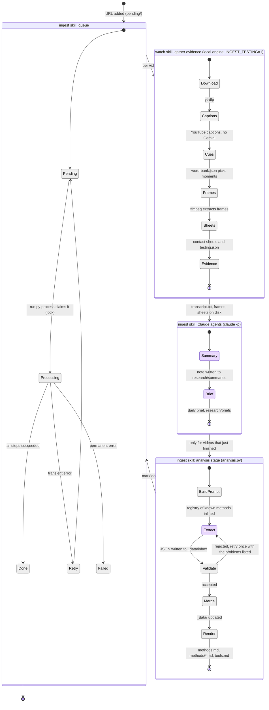

# Ingest pipeline: layers and who does the work

Which layer lives in which skill, and which steps are done by **Claude** (Anthropic), **Google** (Gemini API) or plain **local** code (Python, yt-dlp, ffmpeg).

Colour key used in the diagrams: 🟣 Claude · 🔵 Google (Gemini) · ⚪ local code, no model.

## 1. YouTube videos (the main path)

**No Google step in this path.** `watch.py` never uploads YouTube audio to Gemini (`choose_backend` returns the non-Gemini fallback for YouTube), and `--testing` refuses `--engine gemini`. Transcripts come from YouTube's own captions, with the local/other speech fallbacks only if a video has none.

## 2. Instagram reels (the other path)

```mermaid
stateDiagram-v2
    direction LR

    [*] --> ReelPending: reels CLI adds a reel
    ReelPending --> Audio: reel_fetch.py
    Audio --> Gemini: audio only, 16 kHz mono mp3
    Gemini --> Transcript: timestamped speech
    Transcript --> ReelNote: Claude summarises the transcript
    ReelNote --> [*]: research/reels

    classDef claude fill:#e9d8fd,stroke:#6b46c1,color:#000
    classDef google fill:#d6e9ff,stroke:#2b6cb0,color:#000
    classDef local fill:#eeeeee,stroke:#666,color:#000
    class ReelPending,Audio,Transcript local
    class Gemini google
    class ReelNote claude
```

Gemini is used here because a reel has no captions. Only the audio track is sent, and the temporary files are deleted after the call. Reels are not run through the analysis stage.

## 3. Who does what

| Step | Skill / file | Done by | Output |
|---|---|---|---|
| Queue, locking, retries, schedule | ingest: `run.py`, `store.py` | Local code | `queue/*` |
| Download, captions | watch: `download.py` | Local (yt-dlp), YouTube captions | transcript |
| Cue selection | watch: `testing.py`, `training/word-bank.json` | Local code | `testing.json` |
| Frames and contact sheets | watch: `frames.py` | Local (ffmpeg) | `frames/`, `sheets/` |
| Per-video summary | ingest: summary prompt, `claude_runner` | **Claude** | `research/summaries/<id>-*.md` |
| Daily brief | ingest: `brief.py` | **Claude** (fallback text if it fails) | `research/briefs/` |
| Reel transcription | ingest: `reel_fetch.py`, watch: `gemini.py` | **Google (Gemini)** | transcript line |
| Reel note | ingest: `reels.py` | **Claude** | `research/reels/` |
| Analysis extraction | ingest: `analysis-prompt.md` | **Claude** | `_data/inbox/<id>.json` |
| Validate, merge, render | ingest: `analysis.py` | Local code | `_data/`, `methods.md`, `methods/*.md`, `tools.md` |

## 4. Boundaries worth knowing

- **Claude never touches the merge.** It only writes one JSON file per video. Matching, counting and rendering are deterministic Python, so a bad model answer is rejected by `validate_observation` instead of corrupting the data.
- **Google is only on the reel path.** Everything in section 1 runs without a Gemini key.
- **Failures are contained.** A failed brief or a failed analysis never fails the video. The analysis is retried by `run.py analyze --missing`.
- **Where the stages are called from:** `run_process` in `run.py` runs summary, then brief, then analysis. `run.py analyze` runs only the last stage by hand.
